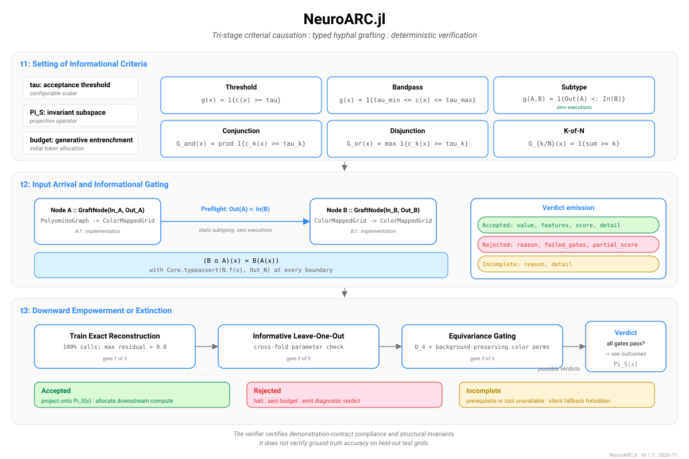
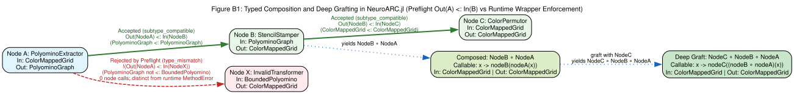
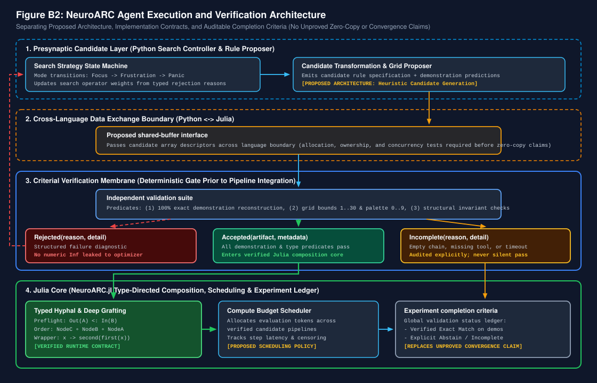

<div align="center">
  
  <h1>NeuroARC.jl</h1>
  <p><strong>A Typed Julia Framework for Criterial Causation, Hyphal Grafting, and Autonomous Visual Reasoning</strong></p>

  <p>
    <a href="https://github.com/aurascoper/NeuroARC.jl/actions/workflows/julia_ci.yml">
      
    </a>
    <a href="https://julialang.org/">
      
    </a>
    <a href="#6-repository-governance--lifecycle">
      
    </a>
    <a href="NeuroARC_manuscript.pdf">
      
    </a>
  </p>
</div>

---

## Overview

**`NeuroARC.jl`** is a zero-dependency Julia reference package designed to formalize visual abstraction and program synthesis on the Abstraction and Reasoning Corpus (ARC).

Standard search-based solvers frequently suffer from three systemic defects:
1. **Untyped Dynamic Composition**: Program synthesis chains fail at runtime due to silent type coercions or unexpected intermediate grid representations.
2. **Numerical Sentinel Pollution**: Failure states encoded as `-1.0` or `Inf` leak into heuristic scoring functions and distort beam search trajectories.
3. **Category Conflation**: Exploratory heuristic matches are frequently mislabeled as verified invariants without formal out-of-sample or symmetry checks.

`NeuroARC.jl` resolves these failure modes by implementing **Criterial Causation** (following Peter Tse, 2013), **Hyphal Grafting Composition Contracts**, and an isolated **Leave-One-Out (LOO) Deterministic Verifier** in pure Julia.

---

## 1. Epistemic Stratification & Track Separation

A foundational design invariant of this project is strict epistemological stratification across three research tracks:

* **Track 1 (Kaggle ARC-AGI-2 Submission Track)**: The Python test-time training (NVARC) and symbolic sidecar submission pipeline evaluated on the ARC Prize 2026 semi-private leaderboard (`31.94` and `29.72` under our triple-pass schedule; `30.28` on S1, `28.47` on the triangulated replicate, and also `28.47` on S5 across three sidecar-enabled runs). Track 1 runs in Python on Kaggle's offline four-L4 GPU environment within the twelve-hour wall-clock limit; its failure audit motivated the formal contracts in Track 3.
* **Track 2 (Coevolutionary Aesthetics & Interface Theory Track)**: Maintained as a strictly minimalist, conservative mathematical track examining whether a coevolved aesthetic preference relation (Prum, 2013) escapes the 2006 Scrambling Theorem or is carried by a functional bijection (Hoffman, 2006; Hoffman, Singh, and Prakash, 2015). No ARC benchmark heuristics, prompt tokens, or algorithmic operators enter Track 2.
* **Track 3 (`NeuroARC.jl` Formal Verification & Composition Track)**: This repository. Provides the standalone Julia formalization for criterial logic gates, constructive proof and refutation certificates, preflight typed composition (`HyphalGraftingContract`), morphological invariants, and pedagogical scaffolding.

---

## 2. Core Architecture

### 2.1 Tri-Stage Criterial Causation & Constructive Evidence (`TransjectionCalculus`)
Operationalizes informational gating across three sequential stages:
* **Stage $t_1$ (Criteria Configuration)**: Configures acceptance thresholds $\boldsymbol{\tau}$, invariant subspace projections $\Pi_{\mathcal{S}}$, and computational budgets weighted by generative entrenchment (Wimsatt, 1986).
* **Stage $t_2$ (Informational Gating)**: Evaluates candidate grid states $x \in \mathcal{X}$ across composable logic gates:
  * `ThresholdGate`: $g(x) = \mathbf{1}\{c(x) \ge \tau\}$
  * `BandpassGate`: $g(x) = \mathbf{1}\{\tau_{\min} \le c(x) \le \tau_{\max}\}$
  * `SubtypeGate`: $g(A, B) = \mathbf{1}\{\mathrm{Out}(A) <: \mathrm{In}(B)\}$ *(evaluated with zero node executions)*
  * `ConjunctionGate` ($\land$), `DisjunctionGate` ($\lor$), and `KOfNGate` ($k/N$)
* **Stage $t_3$ (Downward Empowerment or Extinction)**: Emits operational three-way verdicts (`Accepted`, `Rejected`, `Incomplete`) backed by a formally constructive proof calculus (`EvidenceStatus`: `Witness{T, C <: AbstractProofTerm}`, `Refutation{T, C <: AbstractRefutationTerm}`, and `Unresolved{T}`) with Brouwer-Heyting-Kolmogorov (BHK) combinators (`conjunction_evidence`, `disjunction_evidence`). Inner constructors invoke `check_proof_term` and `check_refutation_term` at instantiation time (with fail-closed `Any` fallbacks), verifying the structural hash seal, proposition alignment, and internal consistency of recorded certificate fields while keeping missing prerequisites in `Unresolved{T}`.

### 2.2 Non-Injective Transjection Operators
Defines the transjection mapping $\mathcal{T}: \mathcal{X} \times \mathcal{C} \to \mathcal{Y} \cup \{\bot\}$:

$$\mathcal{T}(x, \mathcal{C}) = \begin{cases} \Pi_{\mathcal{S}}(x) & \text{if } G_{\mathcal{C}}(x) = 1 \\ \bot & \text{if } G_{\mathcal{C}}(x) = 0 \end{cases}$$

By formalizing $\mathcal{T}$ as a non-injective projection ($\dim(\mathcal{Y}) \ll \dim(\mathcal{X})$) rather than a bijection, `NeuroARC.jl` achieves equivalence-class compression across nuisance variations while avoiding the bijective Scrambling Theorem.

### 2.3 Hyphal Grafting & Deep Composition (`HyphalGraftingContract`)
Multi-step operator synthesis is governed by explicit domain and codomain type contracts (`GraftNode{In, Out}`):
* **Preflight Type Checking**: `can_graft(A, B)` verifies $\mathrm{Out}(A) <: \mathrm{In}(B)$ purely at the type level with **zero executions** of `A.fn` or `B.fn`.
* **Runtime Boundary Enforcement**: `try_graft` and `try_deep_graft` enforce `isa(y, Out)` at every intermediate link in an $N$-step chain, catching type drift at the exact offending boundary.

<div align="center">
  
  <p><em>Figure B1: Typed Hyphal Grafting and Deep Composition Contract vs. Untyped Runtime Failure.</em></p>
</div>

### 2.4 Deterministic Verification & Epistemic Invariants
Before any candidate program is admitted into the verified execution pool, `verify_candidate` enforces three deterministic gates:
1. **Train Exact Reconstruction**: $100\%$ cell-wise match across all training demonstrations ($Y_i = f(X_i)$, maximum cell residual $= 0.0$).
2. **Informative Leave-One-Out (LOO) Cross-Validation**: Refits rule parameters across $N-1$ folds (`evaluate_loo`) to prevent single-task lookup memorization.
3. **Three-Valued Equivariance Gating**: Tests commutation with the eight symmetries of the square ($D_4$, order 8) and background-preserving color permutations. Orientation-dependent rules are flagged as `:untestable` -> `:incomplete` rather than producing false-positive certifications.

The package exports seven `AbstractGridRule` subtypes: three rules with complete execution methods (`MarkerLineReflectionRule`, `ArcGeyserRule`, and `ArcGyrismRule`) and four typed extension stubs (`GeodesicBarrierFloodRule`, `CorridorWireTraceRule`, `PeriodicStampWithPriorityRule`, and `ExactCoverPolyominoRule`) that throw `RuleNotImplementedError` and evaluate to `:incomplete` under `verify_candidate`.

<div align="center">
  
  <p><em>Figure B2: NeuroARC Agent Execution and Verification Architecture.</em></p>
</div>

---

## 3. Repository Layout

```text
NeuroARC.jl/
├── Project.toml                 # Package UUID, version bounds (Julia 1.10-1.13), weakdeps
├── src/
│   ├── NeuroARC.jl              # Main module exports
│   ├── types.jl                 # GridState, ConnectedComponent, ARCTask, Candidate
│   ├── component.jl             # 8-connected components, Euler characteristic, holes
│   ├── rules/                   # Implemented rules (Reflection, Geyser, Gyrism) & typed stubs
│   ├── verifier/loo.jl          # Train-exact, LOO cross-validation, D_4 (order 8) equivariance
│   ├── bridge/json_parser.jl    # Zero-dependency JSON parser & rule compiler
│   └── transjection/
│       ├── calculus.jl          # Criterial logic gates, constructive certificates, scaffolding
│       └── grafting.jl          # Typed hyphal grafting & deep composition contracts
├── ext/                         # Optional package extensions (Metal, JACC, Turing)
├── test/
│   ├── runtests.jl              # Master test runner (652 assertions)
│   ├── test_core.jl             # Core types, topology, rules, LOO verifier tests
│   ├── test_transjection.jl     # Criterial gates, certificates, morphology, scaffolding tests
│   ├── test_grafting.jl         # Preflight type-checking & DOT/SVG generation tests
│   └── check_text_clean.py      # Epistemic text cleanliness & quarantine audit
└── manuscript/
    ├── main.tex                 # LaTeX manuscript source
    ├── sections/                # Modular manuscript sections (01 to 07)
    ├── figures/                 # Graphviz DOT, SVG, and PDF architectural diagrams
    └── build_pdf.sh             # Reproducible Graphviz + Tectonic build script
```

---

## 4. Quickstart & Verification

### Running the Test Suite
`NeuroARC.jl` requires **Julia 1.10+** and zero external packages for its core test suite:

```bash
julia --project=. -e 'using Pkg; Pkg.test()'
```

All **652 unit test assertions** (covering core grid types, topology, LOO verification, constructive evidence certificates, BHK combinators, scientific claim boundary audits, preflight hyphal grafting contracts, and the automated text cleanliness audit) execute out-of-the-box.

### Building the Manuscript PDF
To compile the manuscript (`manuscript/main.pdf`) from source using `graphviz` (`dot`) and `tectonic`:

```bash
cd manuscript
./build_pdf.sh
```

---

## 5. Minimal Code Example

```julia
using NeuroARC

# 1. Preflight Typed Composition (HyphalGraftingContract)
fixtures = build_canonical_fixtures()

# Verify compatibility at the type level (0 function executions)
@assert can_graft(fixtures.nodeA, fixtures.nodeB) == true
@assert can_graft(fixtures.nodeA, fixtures.nodeC) == false # PolyominoGraph !<: BoundedPolyomino

# Execute a verified 3-stage deep graft chain: GridState -> ColorMappedGrid -> PolyominoGraph -> GridState
grid = GridState(Int8[0 1 0; 1 1 1; 0 1 0])
verdict = try_deep_graft([fixtures.nodeA, fixtures.nodeB, fixtures.nodeD], grid)
@assert verdict.accepted == true

# 2. Criterial Logic Gating (TransjectionCalculus)
gate = ConjunctionGate(:NonEmptyBounded, [
    ThresholdGate(:MinComponents, g -> length(g.components), 1.0),
    BandpassGate(:EulerBand, g -> euler_characteristic(g), -2.0, 5.0)
])
passed, score, msg = evaluate_gate(gate, verdict.output)
```

---

## 6. Repository Governance & Lifecycle

`NeuroARC.jl` is released alongside our ARC Prize 2026 Paper Track submission and companion Kaggle notebooks:

1. **Primary Triple-Pass Notebooks (`31.94` and `29.72` public leaderboard)**: [`woguoat/arc2-nvarc-full-cost-sota-triple-pass`](https://www.kaggle.com/code/woguoat/arc2-nvarc-full-cost-sota-triple-pass) (`31.94`), seed-salted replicate [`aurascoper/arc2-nvarc-triple-pass-r2-salt1`](https://www.kaggle.com/code/aurascoper/arc2-nvarc-triple-pass-r2-salt1) (`29.72`), and [`aurascoper/arc2-nvarc-triple-pass-r4-salt3`](https://www.kaggle.com/code/aurascoper/arc2-nvarc-triple-pass-r4-salt3).
2. **Sidecar-Enabled Levers Notebooks (`30.28`, `28.47`, `28.47`)**: [`aurascoper/arc2-nvarc-levers-s1`](https://www.kaggle.com/code/aurascoper/arc2-nvarc-levers-s1) (`30.28`), [`aurascoper/neuroarc-nvarc-secon-final-triangulated-submission`](https://www.kaggle.com/code/aurascoper/neuroarc-nvarc-secon-final-triangulated-submission) (`28.47`), and [`aurascoper/neuroarc-nvarc-equifinal-s5`](https://www.kaggle.com/code/aurascoper/neuroarc-nvarc-equifinal-s5) (`28.47`).
3. **Epistemic Hygiene**: All source files, tests, and manuscript sections are continuously audited by `test/check_text_clean.py` to enforce zero em-dashes, zero en-dashes, and zero unverified cross-domain terminology.
